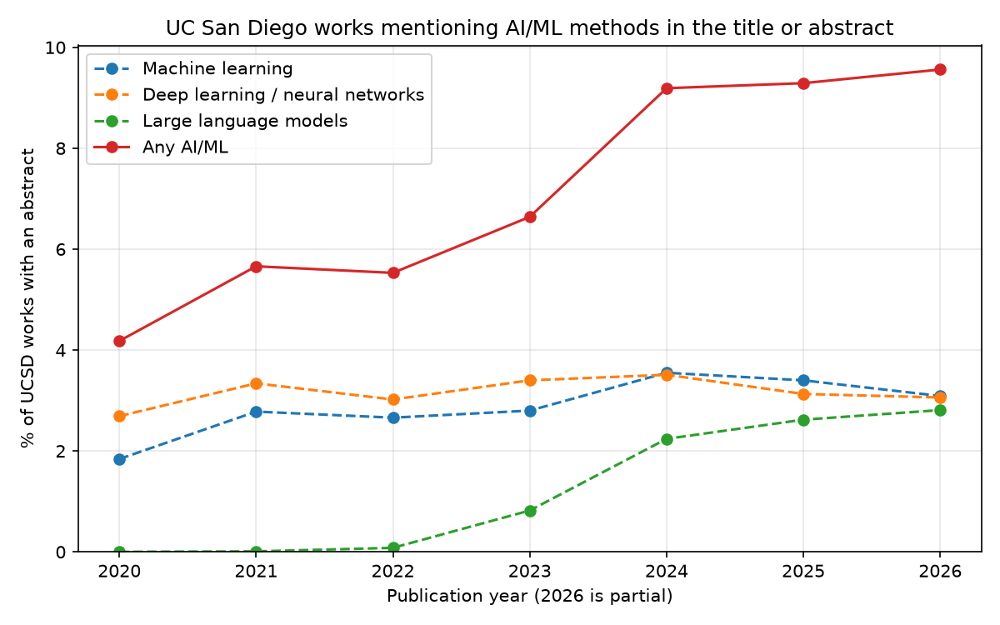
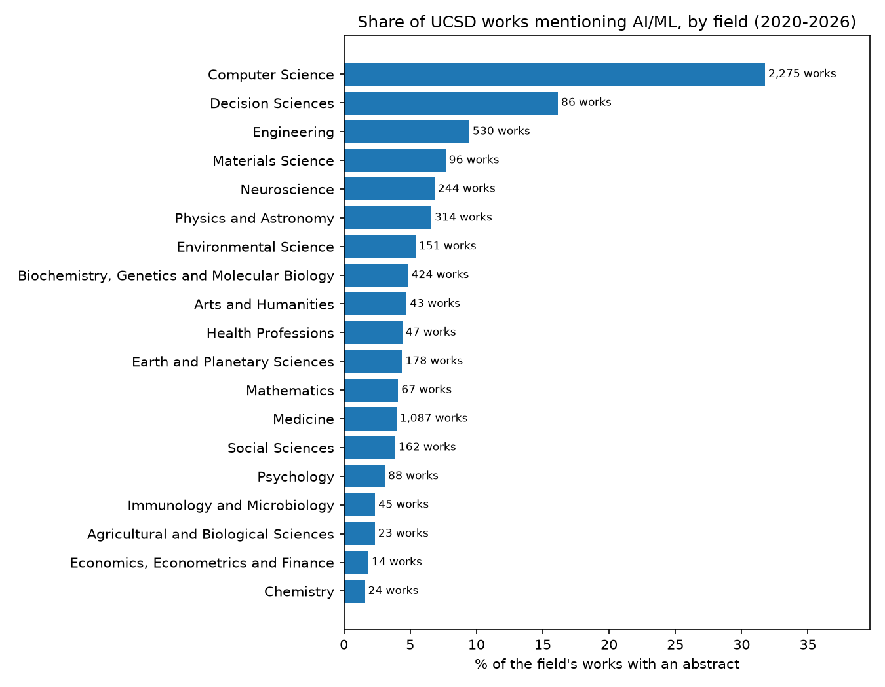

# AI/ML methods in UC San Diego research

## The question

**How has the use of AI/ML methods (machine learning, deep learning, large
language models) in UC San Diego research grown from 2020 to 2026, and in which
research fields?**

As a data science student, I wanted to know how far AI/ML has spread beyond
computer science at UCSD, and whether large language models changed things
after ChatGPT came out in late 2022.

## OpenAlex fields used

| Field | Used for |
| --- | --- |
| `title_and_abstract.search` | finding works that mention each method |
| `has_abstract` | keeping only works that have an abstract to search |
| `publication_year` | trend over time |
| `primary_topic.field` | research field (26 fields, e.g. Medicine, Engineering) |
| `authorships.institutions.id` | the same four UCSD organizations as the data pull |

## How it works

The script asks OpenAlex for counts directly (`group_by`), so it downloads
nothing large and doesn't need an API key. It makes about 20 requests and
finishes in under a minute.

For each method, it counts UCSD works whose title or abstract contains these
terms:

| Method | Search terms |
| --- | --- |
| Machine learning | "machine learning" |
| Deep learning / neural networks | "deep learning" OR "neural network" |
| Large language models | "large language model" OR ChatGPT OR GPT-4 |
| Any AI/ML | any of the above, or "artificial intelligence" |

Each count is divided by the number of UCSD works **with an abstract** in the
same year or field. Works without an abstract (most datasets, and some
publishers that don't share abstracts) can't be searched, so they're left out
of both the count and the total. That's 83,349 of the 131,000 works.

```bash
pip install -r requirements.txt
python ai_ml_methods/ai_ml_methods.py
```

Outputs go to `ai_ml_methods/output/`.

## Results (run 2026-11-18)

### Over time



| Year | Works with abstract | Machine learning | Deep learning / NN | LLMs | Any AI/ML |
| --- | --- | --- | --- | --- | --- |
| 2020 | 10,959 | 1.8% | 2.7% | 0.0% | **4.2%** (458) |
| 2021 | 11,189 | 2.8% | 3.3% | 0.0% | **5.7%** (633) |
| 2022 | 11,220 | 2.7% | 3.0% | 0.1% | **5.5%** (621) |
| 2023 | 12,051 | 2.8% | 3.4% | 0.8% | **6.6%** (800) |
| 2024 | 11,887 | 3.6% | 3.5% | 2.2% | **9.2%** (1,093) |
| 2025 | 12,921 | 3.4% | 3.1% | 2.6% | **9.3%** (1,201) |
| 2026 (partial) | 13,122 | 3.1% | 3.1% | 2.8% | **9.6%** (1,254) |

- The share of UCSD works mentioning AI/ML **more than doubled**, from 4.2% in
  2020 to about 9.5% in 2024-2026.
- **Most of the jump after 2022 comes from large language models.** Mentions
  of "machine learning" and "deep learning" stayed flat at about 3% each
  since 2021, while LLM mentions went from almost zero in 2022 to 2.8% in 2026.
- The biggest single jump is 2023 to 2024 (6.6% to 9.2%), the first full year
  after ChatGPT's release.

### By field



Fields with at least 500 works that have an abstract (full list in
`output/by_field.csv`):

| Field | Works with abstract | AI/ML works | Share |
| --- | --- | --- | --- |
| Computer Science | 7,162 | 2,275 | 31.8% |
| Decision Sciences | 533 | 86 | 16.1% |
| Engineering | 5,601 | 530 | 9.5% |
| Materials Science | 1,252 | 96 | 7.7% |
| Neuroscience | 3,565 | 244 | 6.8% |
| Physics and Astronomy | 4,754 | 314 | 6.6% |
| Medicine | 27,430 | 1,087 | 4.0% |
| Chemistry | 1,520 | 24 | 1.6% |

- Computer science leads by far: about **1 in 3** of its works mentions AI/ML.
- **Medicine has the second-largest number of AI/ML works (1,087)** even
  though only 4% of its works mention AI/ML, simply because it's UCSD's
  largest field. Together, medicine and computer science account for over
  half of all AI/ML works.
- AI/ML shows up across almost every field, including 43 works in Arts and
  Humanities.

## Checking accuracy

- **Do the searches combine terms correctly?** Yes. For example, "large
  language model" (999) OR ChatGPT (154) OR GPT-4 (85) returns 1,083, which is
  less than the sum because some works mention more than one.
- **Do the totals agree?** The field counts add up to 6,058 AI/ML works and
  the year counts to 6,060. The 2 missing works have no field assigned.
- **Are the matches really about AI/ML?** `output/sample_matches.csv` has 20
  random matching titles for each method. Reading them, about 18 of 20 are
  clearly AI/ML research. The misses are mostly neuroscience papers about
  biological neural networks (for example, a fruit-fly study), or papers that
  mention AI only in passing.

## Limitations

- **"Mentions" isn't the same as "uses".** A work counts if its title or
  abstract mentions a term, including reviews or papers that only discuss AI.
- **"Neural network" also matches neuroscience,** which slightly inflates
  Neuroscience and the deep learning line.
- **Search terms are a choice.** Methods described in other words (for example,
  "random forest" or "transformer") are missed unless they also say "machine
  learning". The terms are set at the top of the script and are easy to change.
- **36% of works have no abstract** and are left out entirely.
- **Field = the work's primary topic,** assigned by OpenAlex's classifier, not
  the authors' department.
- **2026 is a partial year** and OpenAlex counts change week to week (see the
  API approach README).

## Ideas for next steps

- Break down the "Any AI/ML" trend by field over time, to see whether the LLM
  jump is mostly computer science or spread across fields.
- Look at which UCSD authors or departments publish the most AI/ML work, using
  `authorships`.
- Compare with peer universities by changing the institution IDs.
